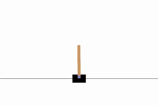
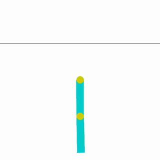
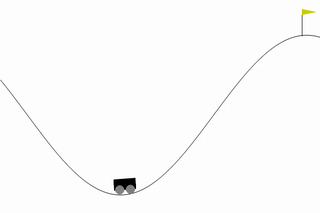
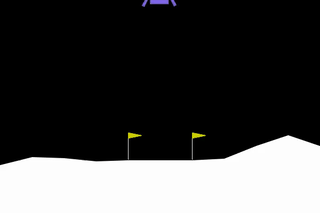
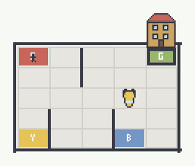
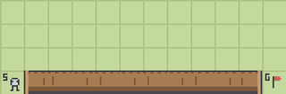
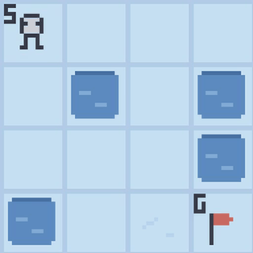

<div align="center">
  <h1>A2C · TD(0)</h1>
  <h3>A small update. Seven environments. All targets met.</h3>
  <p>A compact PyTorch actor–critic, from balancing poles to landing on the moon.</p>
  <p>
    
    
    
    
    <a href="LICENSE"></a>
  </p>
  <p><a href="#reproduce">Run it</a> · <a href="#results">Scores</a> · <a href="#the-small-part">The algorithm</a> · <a href="results/scores.md">Full report</a></p>
</div>

One-step advantage actor–critic reaches the reference targets in **seven selected
Gymnasium environments**, using two small neural networks and a compact learning
update. The same algorithm handles continuous observations and discrete states,
with no reward shaping.

<table>
  <tr>
    <td valign="top" align="center" width="33%"><strong>CartPole</strong><br></td>
    <td valign="top" align="center" width="33%"><strong>Acrobot</strong><br></td>
    <td valign="top" align="center" width="33%"><strong>MountainCar</strong><br></td>
  </tr>
  <tr>
    <td valign="top" align="center"><strong>LunarLander</strong><br></td>
    <td valign="top" align="center"><strong>Taxi</strong><br></td>
    <td valign="top" align="center"><strong>CliffWalking</strong><br></td>
  </tr>
  <tr>
    <td colspan="3" align="center"><strong>FrozenLake · slippery by design</strong><br><br><sub>72.7% success over 1,000 episodes; this fixed-seed demo falls into a hole.</sub></td>
  </tr>
</table>

Every GIF shows the first evaluation episode, seed 1000; demos are not selected
for their outcome.

## The small part

The learning equations fit in about ten lines. Here they are with short names;
the [implementation](a2c/agent.py) adds tensor conversion and optimizer steps:

```python
with torch.no_grad():
    next_values = critic(next_states).squeeze(-1)
    targets = rewards + gamma * torch.where(terminated, 0.0, next_values)
values = critic(states).squeeze(-1)
policy = torch.distributions.Categorical(logits=actor(states))
advantage = targets - values.detach()
critic_loss = torch.nn.functional.mse_loss(values, targets)
actor_loss = -(policy.log_prob(actions) * advantage).mean()
actor_loss -= beta * policy.entropy().mean()
```

The critic learns the one-step return; the actor makes actions with positive
advantage more likely. Entropy encourages exploration. Time limits still
bootstrap from the final observation; true terminal states do not.

Both networks have two 64-unit Tanh layers with orthogonal initialization.
Training collects transitions from 64 environments. Discrete states become
one-hot vectors and use exploring starts during training; evaluation always uses
normal starts. The presets tune learning rates, exploration, and training budgets
per environment; MountainCar also uses observation scaling and longer training
episodes.

## Results

**All seven reference targets met**, evaluated with greedy actions over the same
1,000 episode seeds (1000–1999).

<!-- scores:start -->

| Environment | Target mean ≥ | Achieved mean ± std | Target met |
| :-- | --: | --: | :--: |
| Acrobot-v1 | -100 | -82.31 ± 20.33 | ✓ |
| CartPole-v1 | 475 | 500.00 ± 0.00 | ✓ |
| CliffWalking-v1 | -13 | -13.00 ± 0.00 | ✓ |
| FrozenLake-v1 | 0.7 | 0.727 ± 0.446 | ✓ |
| LunarLander-v3 | 200 | 238.21 ± 54.80 | ✓ |
| MountainCar-v0 | -110 | -106.70 ± 12.70 | ✓ |
| Taxi-v4 | 8 | 8.09 ± 2.72 | ✓ |

<!-- scores:end -->

Six targets are Gymnasium's registered reward thresholds. CliffWalking's project
target is the optimal safe route (−13), evaluated with a 200-step cap; it has no
official Gymnasium reward threshold. FrozenLake's mean return is its success rate.

These are selected training seeds, not averages across independent training runs.
MountainCar is particularly seed-sensitive. Exact results can differ across
platforms; see PyTorch's [reproducibility notes](https://docs.pytorch.org/docs/stable/notes/randomness.html).
The [full report](results/scores.md) includes every preset and training curve.

## Reproduce

Install [uv](https://docs.astral.sh/uv/getting-started/installation/), then run from
the repository root:

```sh
sh scripts/reproduce.sh
```

One command installs locked dependencies, trains all seven presets on CPU with one
computation thread, evaluates each on 1,000 episodes, and records the demos.
No display or GPU is required. It performs full training, so allow time to finish.

- `runs/`: saved settings, final weights, metrics, and analysis; ignored by Git.
- `results/`: seven GIFs, seven training plots, and `scores.md`.

Existing run folders are never overwritten. Use a fresh prefix for another pass:

```sh
sh scripts/reproduce.sh repeat runs/repeat-results
```

## Train and analyse

```sh
uv sync --locked
uv run python -m experiments.train --env CartPole-v1 --run-name cartpole-s42 --seed 42 --total-steps 500000
uv run python -m experiments.analyse --run-name cartpole-s42 --record
uv run python -m experiments.analyse --run-name cartpole-s42 --watch
uv run python -m experiments.scores cartpole-s42 --output runs/my-scorecard
```

Use `--help` for learning rates, discount, entropy, Adam epsilon, observation
scaling, and training episode limits. Run names are required. `--device` defaults
to `auto` (CUDA when available, otherwise CPU); `cpu`, `cuda`, and `mps` can also
be selected explicitly.

<details>
<summary>Run and analysis details</summary>

The step budget counts transitions across all 64 training environments, rounded
up to a full batch. Weights are saved only at successful completion. Device
selection is not stored with a run.

Analysis defaults to 100 episodes, restores saved observation scaling, and uses
normal starts and evaluation limits. It saves evaluation JSON, a training plot,
and an optional MP4 inside the run. Selecting both `--watch` and `--record`
displays and records the same episode.

</details>

## Development

```text
a2c/          # agent, model, transition collector
experiments/  # configuration, environments, training, storage, analysis, scores
scripts/      # reproduction script
results/      # GIFs, training plots, scores.md
runs/         # full local experiments, ignored
tests/
```

Pydantic validates configuration and run data. Ruff handles formatting and import
order; Pyright checks types in standard mode.

```sh
uv run ruff check .
uv run ruff format --check .
uv run pyright
uv run python -m unittest discover -s tests -v
```

## License

[MIT](LICENSE) · Copyright © 2026 enri8421.
