# Reference scores

1000 episodes per environment · greedy actions · seeds 1000–1999.
Evaluation uses standard starts and episode limits; CliffWalking uses a 200-step cap.
Higher scores are better.

| Environment | Target mean ≥ | Achieved mean ± std | Target met |
| :-- | --: | --: | :--: |
| Acrobot-v1 | -100 | -82.31 ± 20.33 | ✓ |
| CartPole-v1 | 475 | 500.00 ± 0.00 | ✓ |
| CliffWalking-v1 | -13 | -13.00 ± 0.00 | ✓ |
| FrozenLake-v1 | 0.7 | 0.727 ± 0.446 | ✓ |
| LunarLander-v3 | 200 | 238.21 ± 54.80 | ✓ |
| MountainCar-v0 | -110 | -106.70 ± 12.70 | ✓ |
| Taxi-v4 | 8 | 8.09 ± 2.72 | ✓ |

FrozenLake's mean return is its success rate. Its slippery dynamics can cause
individual failures, including the fixed first-seed demo, even with an optimal policy.

Targets come from Gymnasium's registered reward thresholds, except CliffWalking:
its project target of −13 is the optimal 13-step safe route (no official threshold).
The 200-step cap prevents an unsuccessful CliffWalking policy looping forever. These are selected
single-seed examples, not averages across independent training runs.

## Training settings

| Environment | Seed | Steps | Critic LR | Actor LR | Gamma | Entropy | Adam ε | Scaling | Episode limit |
| :-- | --: | --: | --: | --: | --: | --: | --: | :--: | --: |
| Acrobot-v1 | 11 | 750,016 | 0.001 | 0.0005 | 0.99 | 0.01 | 0.001 | No | 500 |
| CartPole-v1 | 23 | 1,000,000 | 0.0005 | 0.0002 | 0.99 | 0.001 | 0.001 | No | 500 |
| CliffWalking-v1 | 2 | 100,032 | 0.001 | 0.001 | 0.99 | 0.01 | 0.001 | No | 200 |
| FrozenLake-v1 | 11 | 1,000,000 | 0.001 | 0.001 | 0.99 | 0.01 | 0.001 | No | 100 |
| LunarLander-v3 | 61 | 6,000,000 | 0.001 | 0.0005 | 0.99 | 0.05 | 0.001 | No | 1000 |
| MountainCar-v0 | 0 | 3,000,000 | 0.0005 | 0.0002 | 0.99 | 0.001 | 1e-05 | Yes | 1000 |
| Taxi-v4 | 47 | 1,000,000 | 0.003 | 0.003 | 0.99 | 5 | 0.001 | No | 200 |

The reference script uses 64 training environments, CPU execution, one computation thread, and locked dependencies.
Training starts and limits may differ from evaluation. See `scripts/reproduce.sh`.
All runs use two 64-unit Tanh layers with orthogonal initialization.
Discrete-state training uses exploring starts; evaluation always uses normal starts.
Exact results can differ across platforms.

## Runs and previews

### Acrobot-v1

Run: `readme-acrobot-balanced-s11-750k`.

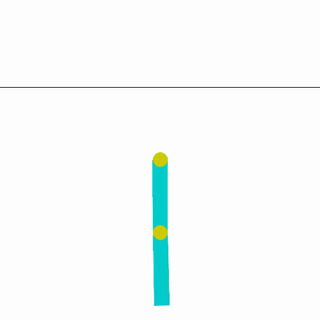

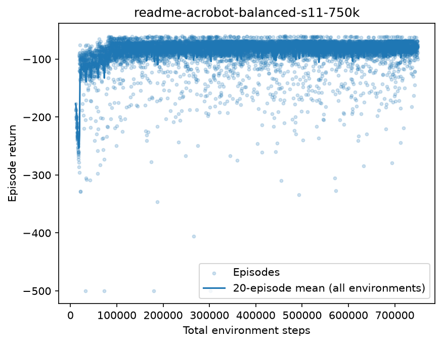

### CartPole-v1

Run: `readme-cartpole-cautious-s23-1m`.

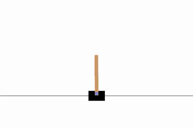

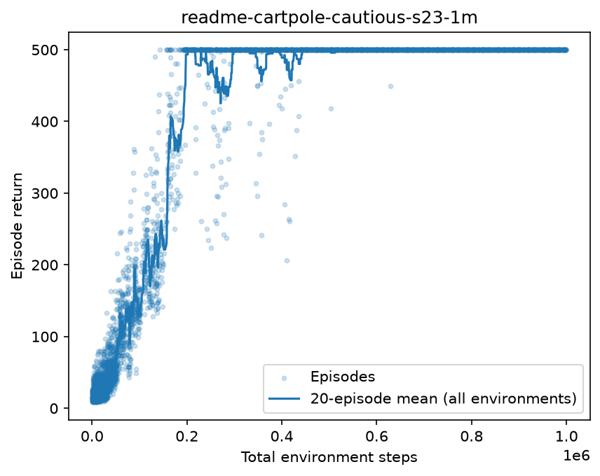

### CliffWalking-v1

Run: `readme-cliffwalking-starts-s2-100k`.

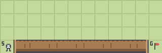

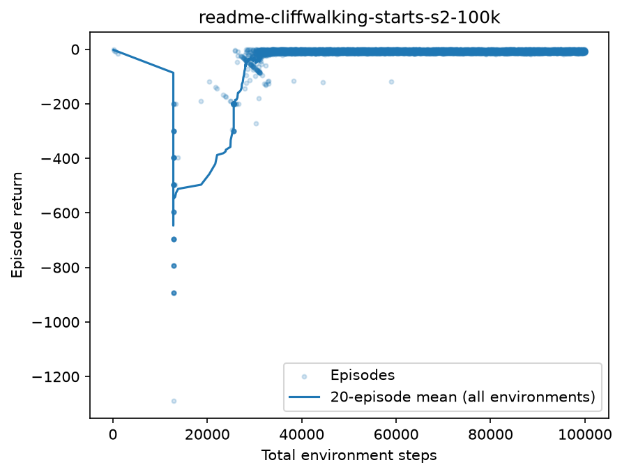

### FrozenLake-v1

Run: `readme-frozenlake-balanced-s11-1m`.

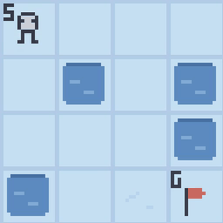

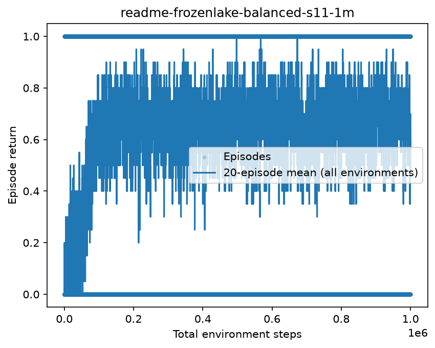

### LunarLander-v3

Run: `readme-lunarlander-explore-s61-6m`.

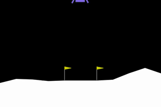

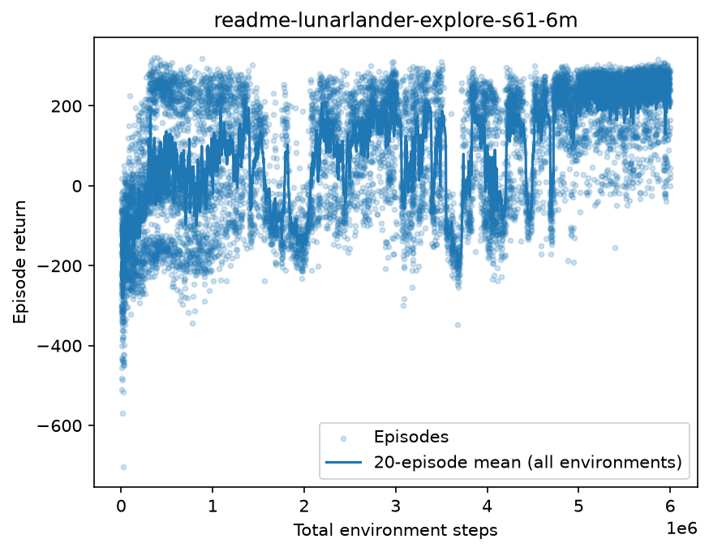

### MountainCar-v0

Run: `readme-mountaincar-tanh-s0-3m`.

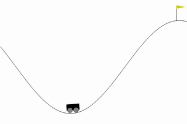

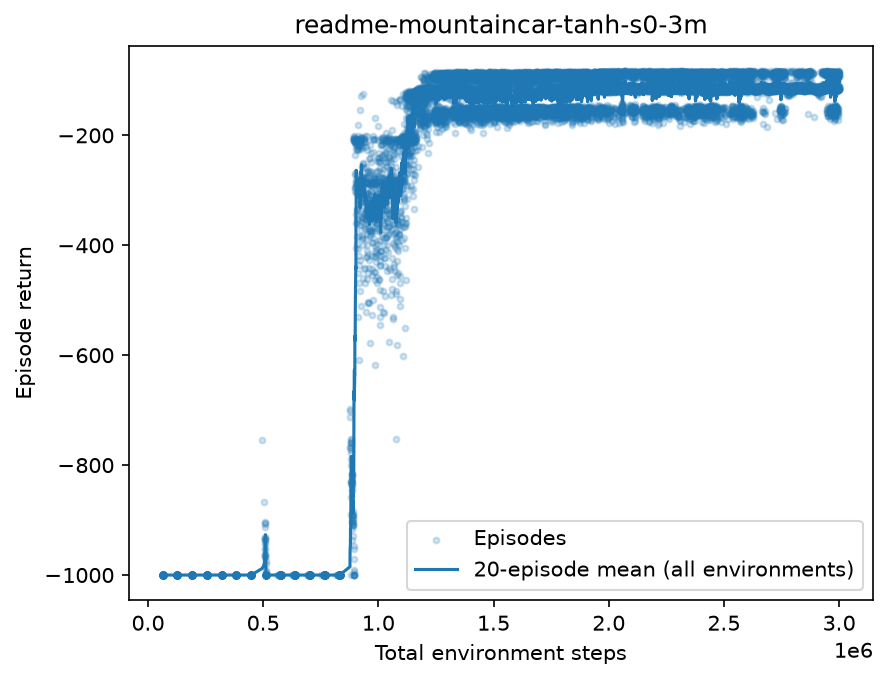

### Taxi-v4

Run: `readme-taxi-explore-s47-1m`.

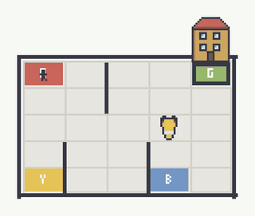

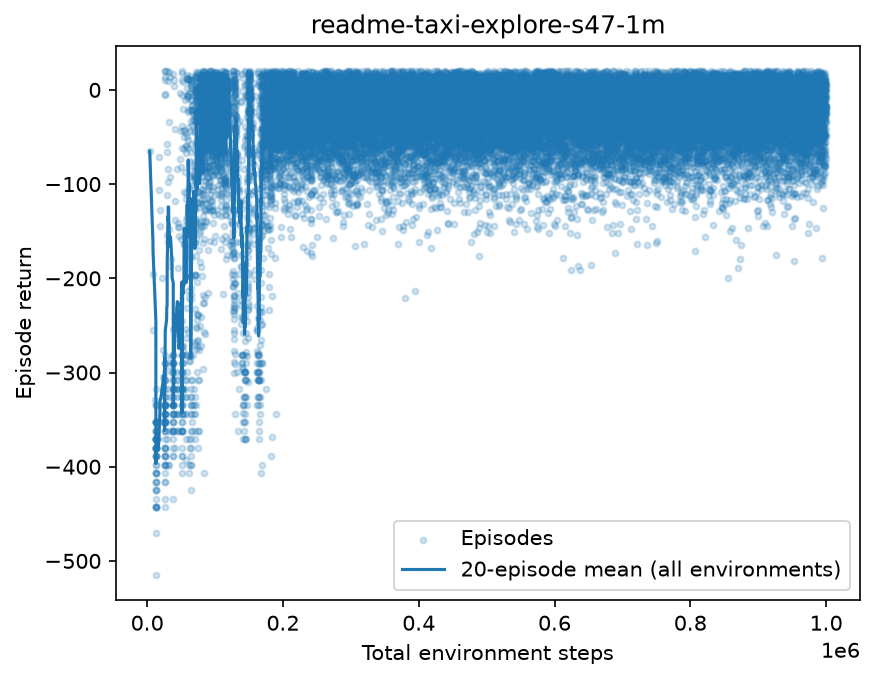
